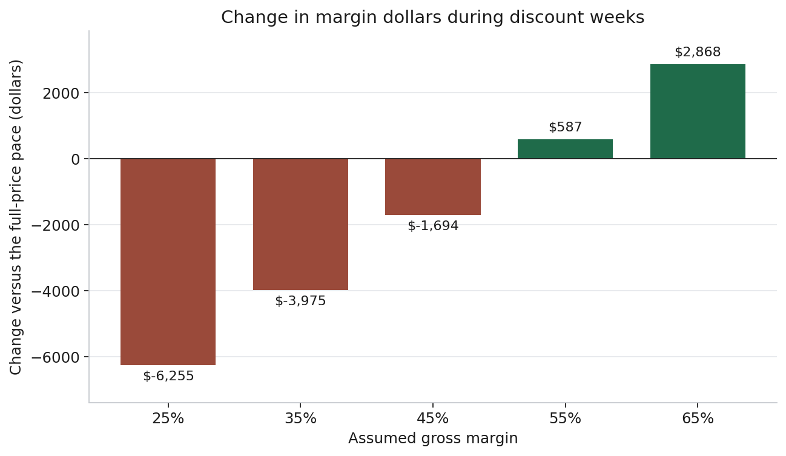
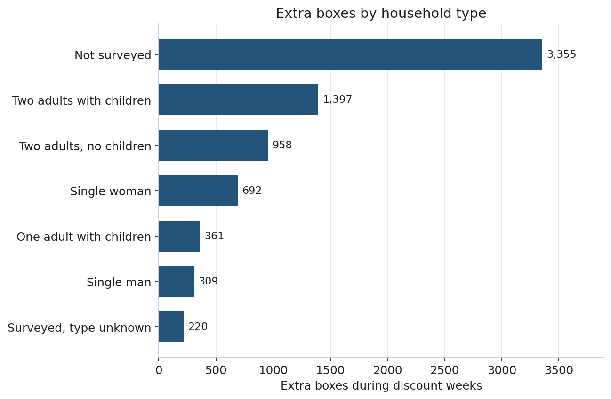
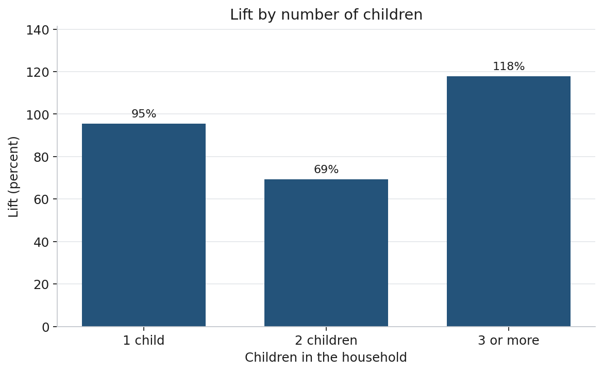
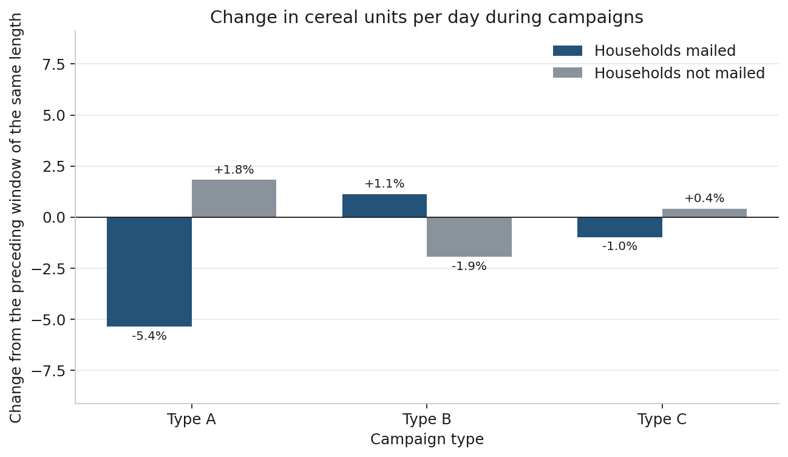

# Cold cereal price discounts

> **Audience.** A brand manager deciding whether to repeat cold-cereal price
> discounts, and a peer analyst who needs the comparison definition before
> reusing the figures.
>
> **Status as of 2026-10-16.** The price-cut comparison, the household and
> product splits, and the campaign comparison are computed. Pull-forward
> (a household buying cereal earlier than it otherwise would have) is still
> open. Raw data stays in `data/` and is not part of the git history.

---

## 1. How to use this document

1. Skim §2 for the question and §4 for the cereal result.
2. Read §3 before using any table. It defines a discount week, extra boxes, lift, and the margin calculation.
3. Use §5–§8 for household composition, number of children, cereal type, and brand.
4. Use §9 for direct-mail campaigns among households with children.
5. §10 is the recommendation. §11 lists limits. §12 reproduces the figures.

### Summary

| Question | Result |
|---|---|
| How many extra boxes did the discount sell, and what gross margin covers the price cut? | **7,291 extra boxes**, 72% above the full-price pace. Anything under **52%** loses money during the discount weeks. The tie is **52.4%**: a gross margin below it loses money, and a margin above it does not. |
| Which household types account for the increase? | Among surveyed households, **two adults with children** account for the most extra boxes. **One adult with children** and **single women** have the highest lift. |
| Does the increase rise with the number of children? | **No.** Households with 3 or more children have the highest lift. Households with 2 children have the lowest of the three groups. |
| Which cereal type responds? | **Kids cereal** accounts for the most extra boxes. **All-family cereal** has the highest lift. **Adult cereal** requires the highest margin. |
| Does brand type change the margin required? | National brands account for more extra boxes and a deeper cut. The margin required is about the same as private label: **52%** and **54%**. |
| Which campaign type is associated with more cereal buying in households with children? | **None.** Type A, Type B, and Type C each change cereal units per day by about 1% to 5%. |

---

## 2. Business question

A higher unit count during a discount is not, by itself, a successful promotion. The shopper pays less per box. Some of the boxes would have sold at full price anyway.

**How many extra boxes did the discount sell, and how high does gross margin need to be for those extra boxes to cover the price cut?**

Gross margin is the share of the full price left after the product's own cost. A full price of $3.11 and a cost of $1.49 is a 52% gross margin. Wages, shipping, and advertising are still unpaid at that point.

The dataset records the price the shopper paid and the retail discount. It does not record unit cost. Every margin below is computed from an assumed cost, equal to the full price times one minus the assumed gross margin.

---

## 3. Comparison

The source is Dunnhumby's Complete Journey: 2,500 households and 711 days at one retailer. Cold cereal contains 638 products. A purchase line is one product in one shopping trip.

Cereal discounts cluster by week. In a given week a product is usually either discounted or full price. A product-week is **on discount** when at least 80% of the boxes sold that week had a retail price cut, and **full price** when 20% or fewer did. Product-weeks between those cutoffs are excluded.

Each of the **203 cereals** with at least two full-price weeks and two discount weeks is compared with itself. Full-price weeks set that product's weekly unit rate. Extra boxes equal the discount-week rate minus the full-price rate, multiplied by the number of discount weeks.

Three measures are reported:

| Measure | Definition |
|---|---|
| Extra boxes | Discount-week units minus the units implied by the full-price weekly rate. |
| Lift | Extra boxes divided by the full-price-pace units. |
| Margin required | Lowest gross margin at which discount-week margin dollars are at least as large as full-price-pace margin dollars. |

---

## 4. Category result

Discount weeks sold **17,456 boxes**. The full-price pace implies **10,165** of those boxes. The difference is **7,291 extra boxes**, a **72%** lift.

The average amount paid in discount weeks was **$2.29** per box. The average full price was **$3.11**. The discount was **27%** of the pre-discount price.



**Figure 1.** Change in margin dollars during discount weeks, relative to selling the full-price pace. Negative bars are assumed gross margins at which the discount weeks earn less.

| Assumed gross margin | Change in margin dollars during discount weeks |
|---:|---:|
| 25% | −$6,255 |
| 35% | −$3,975 |
| 45% | −$1,694 |
| 55% | +$587 |
| 65% | +$2,868 |

Margin dollars are lower at gross margins of 25%, 35%, and 45%, and higher at 55% and 65%. The change is zero at a **52.4%** gross margin.

### Stability of the two-week rule

The result above keeps a cereal only when it has at least two full-price weeks and two discount weeks. The same comparison with a one-week minimum and a four-week minimum:

| Minimum weeks on each side | Cereals | Extra boxes | Lift | Tie |
|---:|---:|---:|---:|---:|
| 1 | 254 | 7,941 | 75% | 51.1% |
| 2 | 203 | 7,291 | 72% | 52.4% |
| 4 | 177 | 7,022 | 72% | 52.8% |

The extra boxes stay near 7,000. The tie stays between 51% and 53%.

---

## 5. Household composition

Household composition is observed for 801 of 2,500 households. Households without demographics are reported as **Not surveyed**. They account for **3,355** of the 7,291 extra boxes. Counts below are households that bought one of the 203 cereals in a week included in the comparison.



**Figure 2.** Extra boxes during discount weeks by household type. Not surveyed households account for the largest share.

| Household | Households | Extra boxes | Lift | Margin required | Change at a 35% margin |
|---|---:|---:|---:|---:|---:|
| Not surveyed | 1,289 | 3,355 | 70% | 53% | −$1,874 |
| Two adults with children | 177 | 1,397 | 87% | 50% | −$669 |
| Two adults, no children | 231 | 958 | 56% | 57% | −$699 |
| Single woman | 135 | 692 | 99% | 45% | −$222 |
| One adult with children | 45 | 361 | 151% | 39% | −$47 |
| Single man | 88 | 309 | 49% | 64% | −$285 |
| Surveyed, type unknown | 70 | 220 | 51% | 62% | −$180 |

Among surveyed households, two adults with children account for the most extra boxes (1,397). One adult with children has the highest lift (151%) and the lowest margin required (39%), on 45 households. Single women have a 99% lift and require a 45% margin. Single men and two adults without children have the lowest lift, 49% and 56%, and require 64% and 57%.

At a 35% margin, every group in the table still shows lower margin dollars during discount weeks. The smallest gap is one adult with children (−$47).

---

## 6. Number of children

§6 is restricted to surveyed households coded as one adult with children or two adults with children. `KID_CATEGORY_DESC` is 1, 2, or 3+.



**Figure 3.** Lift for households with children, ordered by number of children. Lift is lower for 2 children than for 1 child.

| Children | Households | Extra boxes | Lift | Margin required | Change at a 35% margin |
|---|---:|---:|---:|---:|---:|
| 3 or more | 64 | 734 | 118% | 44% | −$194 |
| 1 | 98 | 633 | 95% | 49% | −$295 |
| 2 | 60 | 391 | 69% | 53% | −$226 |

Lift is highest for 3 or more children (118%) and lowest for 2 children (69%). The lift does not increase from 1 child to 2 children. Households with 2 children require a 53% margin, in line with the category result in §4. Households with 3 or more children require 44%.

---

## 7. Cereal type

§7 uses all households. The split is `SUB_COMMODITY_DESC`.

| Cereal | Products | Extra boxes | Lift | Margin required | Change at a 35% margin |
|---|---:|---:|---:|---:|---:|
| Kids cereal | 80 | 3,121 | 64% | 51% | −$1,461 |
| All-family cereal | 60 | 2,620 | 89% | 52% | −$1,585 |
| Adult cereal | 63 | 1,550 | 66% | 55% | −$929 |

Kids cereal accounts for the most extra boxes (3,121). All-family cereal has the highest lift (89%). Adult cereal requires the highest margin (55%) and accounts for the fewest extra boxes. All three types show lower margin dollars at a 35% margin.

---

## 8. Brand

| Brand | Products | Extra boxes | Lift | Average cut on discount weeks | Margin required | Change at a 35% margin |
|---|---:|---:|---:|---:|---:|---:|
| National | 146 | 5,383 | 94% | 31% | 52% | −$3,130 |
| Private label | 57 | 1,909 | 43% | 16% | 54% | −$845 |

National brands have a higher lift (94% versus 43%) and a deeper average cut (31% versus 16%). The margin required is 52% for national brands and 54% for private label.

---

## 9. Campaign type for households with children

Campaigns are direct-mail exposures, recorded separately from the retail price cut. Type A covers 5 campaigns of about 40–55 days. Type B covers 19 campaigns, often about 32 days. Type C covers 6 longer campaigns. The file does not record the products named in the mailing.

The comparison is limited to the 234 surveyed households coded as one adult with children or two adults with children. For each campaign a household received, cereal units per day during the campaign window are compared with cereal units per day over the preceding window of the same length. The same calendar windows are applied to households with children who did not receive that campaign type.



**Figure 4.** Percent change in cereal units per day during each campaign type, compared with the preceding window of the same length. Households with children only.

| Campaign | Households mailed | Change in cereal units per day | Households not mailed | Change in cereal units per day |
|---|---:|---:|---:|---:|
| Type A | 207 | −5.4% | 27 | +1.8% |
| Type B | 174 | +1.1% | 60 | −1.9% |
| Type C | 94 | −1.0% | 140 | +0.4% |

Type A recipients bought 5.4% fewer cereal units per day during the mailing than in the preceding window. The 27 households with children who received no Type A mailing bought 1.8% more over the same dates. Type C is within about one percent in both groups. Type B recipients bought 1.1% more, and households who were not mailed bought 1.9% less. That gap is about three percentage points. Daily cereal volume in these windows is under one tenth of a box per household.

The Type A comparison has little unmatched volume: 207 of 234 households with children received at least one Type A campaign.

---

## 10. Recommendation

Repeat cold-cereal discounts at the observed depth only when gross margin on those products is above the **52.4%** tie. Anything under **52%** loses money during the discount weeks.

Where the margin required is lower than the category result:

- One adult with children requires about **39%**, on 45 households. Two adults with children, the larger of the two groups, require about **50%**. Households with 3 or more children require about **44%**. Single women require about **45%**.
- Kids cereal and all-family cereal require **51%** and **52%**. Adult cereal requires **55%**.
- National brands and private label require **52%** and **54%**.

None of the three campaign types shows a material increase in cereal units per day for households with children.

---

## 11. Limits

| Limit | Implication |
|---|---|
| Unit cost is not in the data | The 52.4% threshold changes if actual cost differs from the assumed share of full price. Group rankings can change with it. |
| 3,355 of 7,291 extra boxes come from households with no demographics | §5 describes surveyed buyers and leaves that volume in the "Not surveyed" row. |
| One adult with children is 45 households | The 151% lift and 39% margin are estimated on the smallest surveyed group in §5. |
| Discount-week units above the full-price pace are all treated as incremental | Purchases shifted forward from a later week remain inside the 7,291. Removing them would reduce extra boxes and raise the margin required. |
| Discount weeks may already have been high-demand weeks | A price cut placed in a week that would have sold more boxes anyway is counted as extra. That would make the 7,291 extra boxes larger than the gain from the price cut, and it would raise the margin required. |
| Campaign content is unknown | §9 measures cereal units around the mailing. It does not measure the campaign's performance against its own offer. |
| One retailer, 2,500 frequent shoppers, day index 1–711 | Results apply to this panel. The file has no calendar dates and no store attributes. |

---

## 12. Reproduce

Download the parquet files and install the packages as described in the repository README. Then, from the project folder:

```bash
python3 analysis/cereal_extra_units.py   # §4
python3 analysis/cereal_story.py         # §5–§9
python3 analysis/build_figures.py        # Figures 1–4
```

`analysis/profile_discounts.py` compares discount frequency across departments and is the basis for restricting the analysis to cold cereal. `data/` is gitignored.
